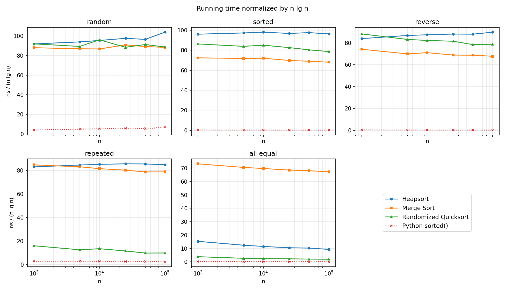
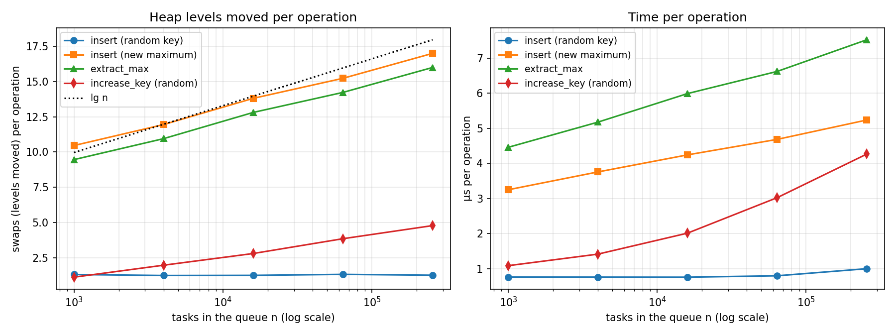
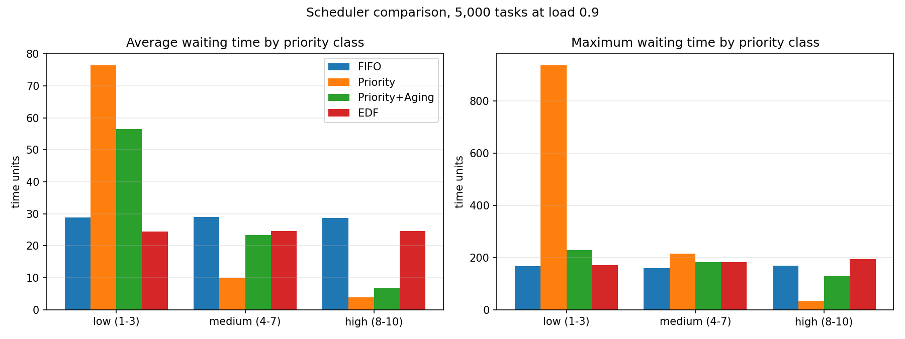
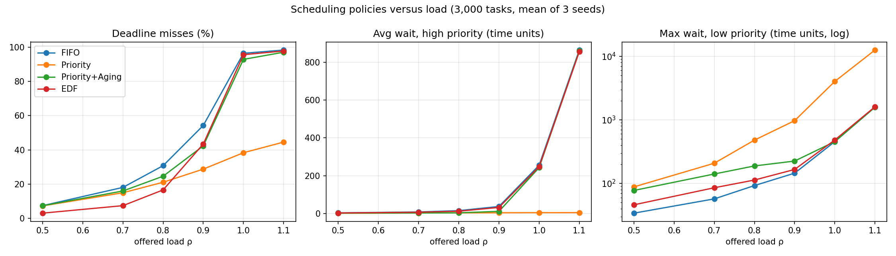
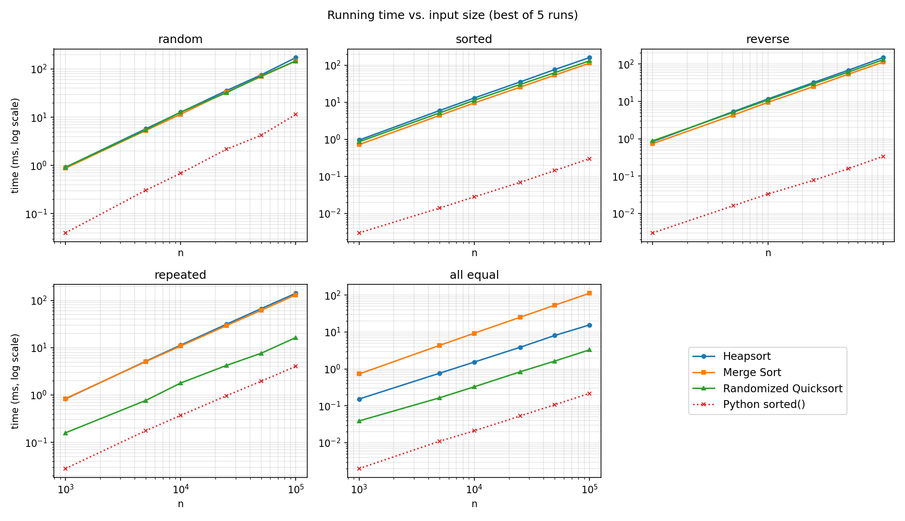
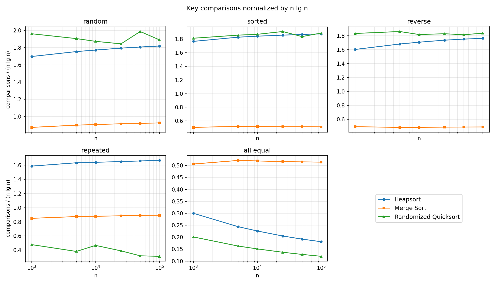
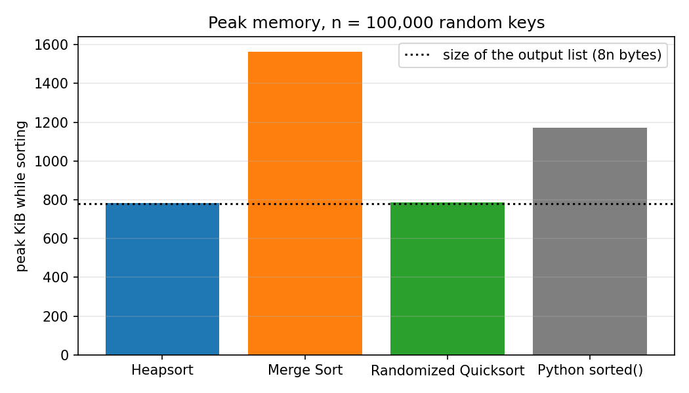

# Heap Data Structures: Implementation, Analysis, and Applications of Heapsort and Priority Queues

Skyler Troxell  
School of Computer and Information Sciences, University of the Cumberlands  
MSCS-532: Algorithms and Data Structures  
Assignment 4  
November 8, 2026  
GitHub Repository: https://github.com/Skyboxii/MSCS532_Assignment4  

## Introduction

A binary heap is one of the most useful structures I know for the amount of code it takes. It is nothing more than an array with a rule about which elements may sit above which, yet it gives an in-place O(*n* lg *n*) sort and a priority queue whose operations all run in logarithmic time. In my integration work the second use is the one that matters: deciding which queued job, file, or retry should run next is a priority-queue problem whether or not anyone calls it that. This report covers both uses. The first part implements Heapsort, proves that it runs in Θ(*n* lg *n*) time, and compares it with Merge Sort and Randomized Quicksort. The second part designs a priority queue of tasks, analyzes each operation, and uses the queue to drive a CPU-scheduling simulation that compares four scheduling policies. The code, tests, raw data, and charts are in the GitHub repository listed on the title page.

## Part 1: Heapsort

### Implementation

A (binary) max-heap is an array *A*[0..*n* − 1] viewed as a nearly complete binary tree: the root is *A*[0], and the children of *A*[*i*] are *A*[2*i* + 1] and *A*[2*i* + 2], so the parent of *A*[*i*] is *A*[⌊(*i* − 1)/2⌋]. The *max-heap property* requires every node to be at least as large as its children, so the largest key is always at the root (Williams, 1964; Cormen et al., 2022, Ch. 6). The tree is implicit in the index arithmetic, which is why no pointers are needed. A heap of *n* elements has height ⌊lg *n*⌋.

`heapsort.py` follows the three procedures in Cormen et al. (2022), translated to 0-based indexing:

- **`max_heapify(A, i, heap_size)`** assumes both subtrees of node *i* are max-heaps and lets *A*[*i*] "sink": it swaps *A*[*i*] with its larger child and repeats from that child until *A*[*i*] is at least as large as both children or reaches a leaf. I wrote it as a `while` loop rather than the textbook's tail recursion, so it uses O(1) extra space.
- **`build_max_heap(A)`** calls `max_heapify` on every internal node from ⌊*n*/2⌋ − 1 down to 0. Leaves are already one-element heaps, and processing nodes bottom-up guarantees that both subtrees of each node are heaps by the time it is processed (Floyd, 1964).
- **`heapsort_inplace(A)`** builds a max-heap, then repeats *n* − 1 times: swap the root (the current maximum) with the last element of the heap, shrink the heap by one, and call `max_heapify(A, 0, heap_size)` to restore the property. The sorted region grows from the right end of the array. `heapsort(A)` is a wrapper that copies the input first so the caller's list is unchanged.

`test_heapsort.py` checks empty, one-element, two-element, duplicated, all-equal, sorted, reverse-sorted, mixed-type, and 200 random arrays against Python's `sorted()`, verifies the heap property after `build_max_heap`, and reproduces the worked examples in Figures 6.2 and 6.3 of Cormen et al. (2022).

### Time Complexity Analysis

**MAX-HEAPIFY.** Each iteration of the loop does a constant amount of work (at most two comparisons and one swap) and moves one level down the tree, so a call on a node of height *h* costs O(*h*). Called on the root it is O(lg *n*).

**BUILD-MAX-HEAP is O(n), not O(n lg n).** A simple bound multiplies *n*/2 calls by O(lg *n*), but most nodes are near the bottom of the tree where *h* is small. A heap of *n* elements has at most ⌈*n*/2<sup>h+1</sup>⌉ nodes of height *h*, so for some constant *c* the total cost is

&emsp;&emsp;Σ<sub>h=0</sub><sup>⌊lg n⌋</sup> ⌈*n*/2<sup>h+1</sup>⌉ · *ch*  ≤  *cn* Σ<sub>h=0</sub><sup>∞</sup> *h*/2<sup>h</sup>  =  *cn* · 2  =  O(*n*),

using the series Σ *h*/2<sup>h</sup> = 2 (Cormen et al., 2022, Section 6.3). Intuitively, half of the nodes are leaves that cost nothing, a quarter can sink at most one level, an eighth at most two, and so on.

**Worst case.** After the build, the sorting loop runs *n* − 1 times, and each iteration does an O(1) swap plus one MAX-HEAPIFY on a heap of at most *n* elements, which costs O(lg *n*). The total is O(*n*) + (*n* − 1) · O(lg *n*) = O(*n* lg *n*). The bound is tight. The key moved to the root in each iteration came from the last leaf, so it is one of the smaller keys in the heap and typically sinks all the way back to the bottom level. Summed over the extractions, that is Σ<sub>k=2</sub><sup>n</sup> ⌊lg *k*⌋ = Θ(*n* lg *n*) levels.

**Best and average cases (distinct keys).** Unlike Quicksort, Heapsort has no lucky inputs. The average case is Θ(*n* lg *n*) because the worst case gives the upper bound and every comparison sort needs Ω(*n* lg *n*) comparisons on average (Cormen et al., 2022, Ch. 8). The best case is also Θ(*n* lg *n*). Schaffer and Sedgewick (1993) proved that even the best input requires about ½*n* lg *n* comparisons and the average input about 2*n* lg *n*. The intuition is that each extraction removes the maximum and replaces it with a leaf, and the next-largest keys are spread through the lower levels of the heap, where they must climb to the root one level at a time. Neither sorted nor reverse-sorted input avoids this. A reverse-sorted array is already a max-heap, so the build phase does almost nothing, but the build is only O(*n*) to begin with; the *n* − 1 extractions still dominate. **Heapsort is therefore Θ(*n* lg *n*) in the worst, average, and best cases.**

**An exception: many equal keys.** The "all cases" statement assumes distinct keys. If every key is equal, MAX-HEAPIFY finds the node already no smaller than its children after two comparisons and stops, so each call costs O(1) and the whole sort costs Θ(*n*). My benchmark confirms this exactly: an all-equal array of 100,000 keys needed 299,994 comparisons, which is 3*n* − 6 (one pass of two comparisons per internal node in the build, then two per extraction).

### Space Complexity and Overheads

Heapsort sorts *in place*. The heap occupies the same array as the input and the sorted output, and the iterative MAX-HEAPIFY needs only a few index variables, so the extra space is O(1). (The recursive textbook version would use O(lg *n*) stack space.) This is its main advantage over Merge Sort, which needs a Θ(*n*) auxiliary array. Its overheads are:

- **More comparisons and data movement.** Each level of a sift costs two comparisons (find the larger child, then compare it with the sinking key) and a swap, so Heapsort makes about 2*n* lg *n* comparisons on average, roughly twice as many as Merge Sort.
- **Poor locality of reference.** The children of *A*[*i*] are at 2*i* + 1 and 2*i* + 2, so each step down the tree jumps twice as far through memory. Once the array is larger than the CPU cache, most of those jumps miss the cache, while Quicksort and Merge Sort scan memory sequentially.
- **Not stable.** Swapping the root with the last element can reorder equal keys, so Heapsort cannot be used where the relative order of equal records matters (for example, a secondary sort).
- **Not adaptive.** It does the same Θ(*n* lg *n*) work on input that is already sorted, whereas Timsort (Python's `sorted()`) finishes sorted input in Θ(*n*).

### Empirical Comparison

`benchmark_sorting.py` ran Heapsort, Merge Sort (from my Assignment 2), Randomized Quicksort with a three-way partition (from my Assignment 3), and Python's built-in `sorted()` on random, sorted, reverse-sorted, repeated (10 distinct values), and all-equal arrays of 1,000 to 100,000 keys using Python 3.13.9 on Windows 11. Each time is the best of five runs, comparisons were counted with a wrapper object, and peak memory was measured with `tracemalloc`. My first run was noisy: the same Heapsort call took anywhere from 150 to 320 ms. The cause was Windows power throttling, which moves a background process onto the laptop's slower efficiency cores. I added a helper (`bench_util.py`) that opts the benchmark process out of throttling, after which 15 consecutive runs varied by less than 10%. Table 1 shows the results at *n* = 100,000.

**Table 1.** *Running Time (ms) and Key Comparisons at n = 100,000*

| Input | Heapsort ms | Heapsort comparisons | Merge Sort ms | Merge Sort comparisons | Quicksort ms | Quicksort comparisons | sorted() ms |
|---|---:|---:|---:|---:|---:|---:|---:|
| Random | 172 | 3,019,603 | 147 | 1,536,206 | 147 | 3,138,166 | 11.40 |
| Sorted | 160 | 3,112,517 | 113 | 853,904 | 131 | 3,131,077 | 0.30 |
| Reverse | 149 | 2,926,640 | 113 | 815,024 | 131 | 3,047,218 | 0.34 |
| Repeated | 141 | 2,766,786 | 131 | 1,483,116 | 16.36 | 519,772 | 4.04 |
| All equal | 15.51 | 299,994 | 112 | 853,904 | 3.28 | 200,000 | 0.22 |

*Note.* Quicksort = randomized, three-way partition. sorted() is Python's built-in Timsort, implemented in C; its comparisons were not counted. n lg n ≈ 1,660,964 for n = 100,000.

**Figure 1.** *Running Time Normalized by n lg n, by Input Distribution*



*Note.* A flat line means the running time grows in proportion to n lg n. Absolute times are in Figure B1.

#### Heapsort behaves the same on every distinct-key input

Heapsort's comparison counts at *n* = 100,000 were 3,019,603 (random), 3,112,517 (sorted), and 2,926,640 (reverse), within about 6% of each other, and Table 2 shows that its comparisons per *n* lg *n* stayed between 1.6 and 1.9 at every size. The ratio is creeping slowly toward 2 because the exact average is about 2*n* lg *n* minus a linear term (Schaffer & Sedgewick, 1993). Time per *n* lg *n* was also flat, around 85–105 ns. Both observations confirm the analysis: there is no input ordering that makes Heapsort quadratic, and no ordering that makes it much faster. Reverse-sorted input was slightly cheaper (149 ms against 172 ms for random input) because the array starts as a valid max-heap and the build phase does no swaps.

**Table 2.** *Heapsort Comparisons and Time Normalized by n lg n*

| n | Comparisons / n lg n (random) | (sorted) | (reverse) | ns / n lg n (random) | (sorted) | (reverse) |
|---|---:|---:|---:|---:|---:|---:|
| 1,000 | 1.696 | 1.764 | 1.602 | 91.84 | 96.04 | 83.89 |
| 5,000 | 1.753 | 1.825 | 1.68 | 93.92 | 97.28 | 86.75 |
| 10,000 | 1.771 | 1.84 | 1.706 | 95.37 | 98.04 | 87.39 |
| 25,000 | 1.793 | 1.855 | 1.735 | 97.54 | 96.79 | 88.07 |
| 50,000 | 1.806 | 1.865 | 1.75 | 96.5 | 97.6 | 87.95 |
| 100,000 | 1.818 | 1.874 | 1.762 | 103.82 | 96.31 | 89.77 |

#### Heapsort compared with Merge Sort and Quicksort

All three algorithms grew as *n* lg *n*, but Heapsort was the slowest of the three on random data: 172 ms against 147 ms for Merge Sort and 147 ms for Quicksort. The comparison counts explain part of this. Heapsort made 3,019,603 comparisons on random input, about twice Merge Sort's 1,536,206, and close to Quicksort's 3,138,166. Quicksort makes up for its comparisons with cheap, sequential partition scans, while Heapsort's sift-down jumps around the array. Merge Sort made the fewest comparisons and was fastest on sorted and reverse-sorted input, where its merge step degenerates into copying one half after the other. On the repeated and all-equal arrays, Quicksort's three-way partition was about 5 to 9 times faster than Heapsort, which in turn beat Merge Sort on all-equal input because of the Θ(*n*) behavior described above. Python's `sorted()` was 10–15 times faster than all three on random data, and hundreds of times faster on sorted input, because it is written in C and detects existing runs.

Table 3 confirms the space analysis. Heapsort's peak memory was 800,276 bytes, essentially the 8-byte-per-element copy that the `heapsort()` wrapper makes of its input, with only 220 bytes beyond it. Quicksort needed about 4 KB more for its O(lg *n*) recursion stack, `sorted()` needed about *n*/2 extra slots for Timsort's merge buffer, and Merge Sort needed a full second copy of the array.

**Table 3.** *Peak Memory While Sorting 100,000 Random Keys*

| Algorithm | Peak bytes | Bytes beyond the input copy | Bytes per element |
|---|---:|---:|---:|
| Heapsort | 800,276 | 220 | 8.0 |
| Merge Sort | 1,600,248 | 800,192 | 16.0 |
| Randomized Quicksort | 804,136 | 4,080 | 8.04 |
| Python sorted() | 1,199,904 | 399,848 | 12.0 |

*Note.* Every function returns a new list, so each peak includes an 8n-byte copy of the input; the third column subtracts it. Measured with tracemalloc, which tracks Python-level allocations.

#### Discrepancies between theory and practice

The asymptotic analysis predicts that the three algorithms are equivalent up to constant factors, and they were. The discrepancies are all about those constants. First, Merge Sort was not slowed by its Θ(*n*) extra memory at this scale; allocating Python lists is cheap compared with interpreting a comparison. Second, Heapsort's time per *n* lg *n* rose about 13% from 1,000 to 100,000 keys on random input while Merge Sort's did not, which is consistent with Heapsort's scattered memory accesses starting to miss the cache as the array grows. Third, in every case the interpreted algorithms lost by an order of magnitude to the C implementation of `sorted()`, a reminder that the constant factor hidden in O(*n* lg *n*) depends heavily on the implementation.

## Part 2: Priority Queue and Scheduler

### Design Choices

**Array (Python list) representation.** I store the binary heap in a Python list. A list is a dynamic array, so the tree is implicit: parent and child positions are computed with the same index arithmetic as in Heapsort, with no node objects or pointers to maintain. Adding a leaf is `append` and removing the last leaf is `pop`, both amortized O(1), and the contiguous layout is friendlier to the cache than a linked tree. A pointer-based tree would need parent, left, and right references in every node and would make "find the last position" awkward, without improving any operation's complexity.

**A Task record.** `Task` is a Python dataclass with `task_id`, `priority` (higher is more urgent), `base_priority` (the priority at arrival, kept separately because aging changes `priority`), `arrival_time`, `duration`, `deadline`, and an optional `name`. The scheduler fills in `start_time` and `finish_time`, and the class derives `waiting_time`, `turnaround_time`, and `missed_deadline` from them.

**Max-heap by default, min-heap when needed.** Priority scheduling serves the most urgent task first, so the default is a max-heap on `priority` with `extract_max()`. The same class becomes a min-heap with `kind="min"`, and a `key_attr` parameter selects the field being compared. That is how the simulation reuses one implementation for every policy: earliest-deadline-first is a min-heap on `deadline`, and FIFO is a min-heap on `arrival_time`. Ties are broken by arrival time and then `task_id`, so tasks with equal priority are served first-come-first-served and every run is deterministic.

**An index map for key changes.** A heap is ordered only along root-to-leaf paths, so finding an arbitrary task would require an O(*n*) scan. To make `increase_key` and `decrease_key` logarithmic, the queue keeps a dictionary from `task_id` to the task's current index in the list and updates both affected entries inside the one `_swap` helper that every sift uses. Locating a task is then an O(1) expected-time dictionary lookup. The cost is O(*n*) extra space and a constant amount of extra work per swap.

### Operations and Their Complexity

All of the analysis rests on one fact: a heap of *n* elements is a nearly complete binary tree of height ⌊lg *n*⌋, and a sift moves an element at most one level per swap, so any single sift costs O(lg *n*) (Cormen et al., 2022, Section 6.5).

- **`insert(task)`: O(lg n).** Append the task as a new leaf, which keeps the tree nearly complete, then sift it up: while it should be served before its parent, swap them. Only the path from the new leaf to the root can be out of order, and the loop stops at the root, so there are at most ⌊lg *n*⌋ swaps. On average the cost is much lower, because a random new key usually belongs near the bottom; the expected number of levels moved is bounded by a constant (Porter & Simon, 1975).
- **`extract_max()` / `extract_min()`: O(lg n).** Save the root, move the last leaf into the root position, pop the old last slot, and sift the new root down by swapping it with its preferred child until neither child should come first. Removing the last leaf keeps the shape valid, and the sift follows one root-to-leaf path, so it costs O(lg *n*). Unlike insert, this is also the typical cost, because the key moved to the root came from the bottom and usually sinks back down.
- **`increase_key(task_id, new)` / `decrease_key(task_id, new)`: O(lg n).** Look up the index in O(1), check the direction (raising a `ValueError` if an "increase" would lower the key), store the new key, and sift. In a max-heap a larger key can only violate the property with the node's parent, so it sifts up; a smaller key can only violate it with the children, so it sifts down. The min-heap is the mirror image. Either way it is one sift of at most ⌊lg *n*⌋ levels.
- **`is_empty()`: O(1)**, checking whether the list is empty. `peek()`, `len()`, and membership tests are also O(1).
- **`build(tasks)`: O(n)** using the bottom-up BUILD-MAX-HEAP procedure analyzed in Part 1, and **`remove(task_id)`: O(lg n)** (swap with the last leaf, pop, then sift the moved task up or down).

The queue uses O(*n*) space: one list slot and one dictionary entry per task. `test_priority_queue.py` checks each operation, the error cases, FIFO tie-breaking, and min-heap mode, and runs 5,000 random inserts, extractions, key changes, and removals against a brute-force reference, verifying the heap property and the index map after every operation.

### Measured Cost of the Operations

`benchmark_priority_queue.py` measured each operation on queues of 1,000 to 256,000 tasks and counted swaps, which equal the number of levels an element moves. Table 4 and Figure 2 show the results. Inserting a task that becomes the new maximum is the worst case for insert: the task climbs the full height of the heap, 17.0 levels at *n* = 256,000 where ⌊lg *n*⌋ = 17. (At small *n* the count is slightly above lg *n* because the queue grows by the 2,000 tasks being inserted during the measurement.) `extract_max` moved one to two levels fewer than lg *n*, and both counts grew by one level each time *n* doubled, which is the logarithmic growth the analysis predicts. Inserting a task with a random priority moved only about 1.3 levels at every size, matching the constant average-case result, and took about 1 µs or less. Building a queue of 256,000 tasks with `build()` took 160 ms against 308 ms for 256,000 separate inserts, and moved fewer than one element per task, which is the O(*n*) versus O(*n* lg *n*) difference.

**Table 4.** *Priority-Queue Operations: Levels Moved (Swaps) and Microseconds per Operation*

| n | lg n | Insert random swaps | µs | Insert max swaps | µs | Extract swaps | µs | Increase-key swaps | µs | build() ms | n inserts ms |
|---|---:|---:|---:|---:|---:|---:|---:|---:|---:|---:|---:|
| 1,000 | 9.97 | 1.31 | 0.758 | 10.46 | 3.248 | 9.46 | 4.458 | 1.12 | 1.083 | 0.55 | 1.15 |
| 4,000 | 11.97 | 1.24 | 0.757 | 11.95 | 3.756 | 10.95 | 5.176 | 1.97 | 1.412 | 2.05 | 4.33 |
| 16,000 | 13.97 | 1.25 | 0.755 | 13.81 | 4.243 | 12.81 | 5.991 | 2.8 | 2.011 | 8.31 | 18.13 |
| 64,000 | 15.97 | 1.32 | 0.795 | 15.23 | 4.685 | 14.23 | 6.623 | 3.85 | 3.023 | 33.74 | 88.28 |
| 256,000 | 17.97 | 1.26 | 0.997 | 17.0 | 5.238 | 16.0 | 7.526 | 4.78 | 4.267 | 159.94 | 307.56 |

*Note.* Averages over 2,000 operations at each queue size. Increase-key raised a random task's priority by a random amount between 0 and 1 on keys drawn from [0, 1).

**Figure 2.** *Heap Levels Moved and Time per Operation Versus Queue Size*



*Note.* The dotted line is lg n. Swaps are exact; times are best-case wall-clock averages.

Time tracked the swap counts closely. `extract_max` went from 4.458 to 7.526 µs as its swaps went from 9.46 to 16.0, about 0.47 µs per level. Each level costs two calls to the tie-breaking comparison method and one swap with two index-map updates, all interpreted Python. The random-key insert stays near 1 µs at every size because it rarely moves more than one or two levels.

### Scheduler Simulation

`scheduler.py` simulates a single CPU that runs one task at a time without preemption. Tasks arrive as a Poisson process with priorities from 1 to 10, durations of 1 to 9 time units (mean 5), and deadlines of arrival + (2 to 10) × duration. The *offered load* ρ is the arrival rate times the mean duration, the fraction of time the CPU must be busy to keep up. Whenever the CPU is free, the simulator inserts every newly arrived task into the priority queue and extracts the next one to run, so each scheduling decision costs O(lg *q*) for a queue of *q* waiting tasks. Four policies run on identical copies of the same workload:

- **FIFO**: min-heap on arrival time (the baseline).
- **Priority**: max-heap on priority.
- **Priority + aging**: before each dispatch, every waiting task's priority is raised by one level for every 25 time units it has waited, up to the maximum of 10, using `increase_key`. This is the standard remedy for starvation.
- **EDF** (earliest deadline first): min-heap on deadline (Liu & Layland, 1973).

Table 5 shows the results for 5,000 tasks at ρ = 0.9, Figure 3 breaks waiting time down by priority class, and Table 7 and Figure 4 repeat the experiment at loads from 0.5 to 1.1.

**Table 5.** *Scheduling Results for 5,000 Tasks at Load 0.9 (Times in Time Units)*

| Policy | Avg wait | 95th pct wait | Max wait | Avg wait, high (8–10) | Avg wait, low (1–3) | Max wait, low (1–3) | Deadline misses % | increase_key calls |
|---|---:|---:|---:|---:|---:|---:|---:|---:|
| FIFO | 28.9 | 98.3 | 168.1 | 28.8 | 28.9 | 167.3 | 45.9 | 0 |
| Priority | 28.5 | 133.5 | 936.0 | 4.0 | 76.4 | 936.0 | 26.2 | 0 |
| Priority+Aging | 28.7 | 130.5 | 229.5 | 6.8 | 56.5 | 229.5 | 35.8 | 4,451 |
| EDF | 24.6 | 95.9 | 193.3 | 24.6 | 24.5 | 171.2 | 34.2 | 0 |

*Note.* All four policies processed the same 5,000 tasks; the longest ready queue was 33 to 36 tasks.

**Figure 3.** *Average and Maximum Waiting Time by Priority Class at Load 0.9*



#### Priority scheduling redistributes waiting time

The most striking result is that FIFO, Priority, and Priority + aging had almost the same average wait (28.9, 28.5, and 28.7 time units). That is not a coincidence. For a non-preemptive scheduler that never leaves the CPU idle and does not choose tasks based on their length, the order of service cannot change the average wait; it can only move waiting time from some tasks to others (Kleinrock, 1976). Priority scheduling moved it dramatically: high-priority tasks waited 4.0 time units on average instead of 28.8, while low-priority tasks waited 76.4 on average and up to 936.0, more than five times FIFO's worst case of 168.1. That is starvation, and it gets worse with load. At ρ = 1.1 the worst low-priority wait under Priority was 12,543 time units (Table 7).

#### Aging trades a little urgency for fairness

Aging cut the worst low-priority wait from 936.0 to 229.5 time units, using 4,451 `increase_key` calls over 5,000 dispatches. The price was paid by the urgent tasks, whose average wait rose from 4.0 to 6.8. Aging improved fairness but not deadlines: low-priority tasks actually missed *more* deadlines with aging (59.1% against 51.5%, Table 6), because a task is promoted only after it has already waited a long time, by which point its deadline has often passed. At ρ ≥ 1, aging degenerates into FIFO. Queues grow without limit, every waiting task reaches the maximum priority of 10, and the tie-break on arrival time takes over. The worst low-priority waits for aging and FIFO at ρ = 1.0 are identical (454 time units).

**Table 6.** *Deadline-Miss Rate (%) by Priority Class at Load 0.9*

| Policy | High (8–10) | Medium (4–7) | Low (1–3) |
|---|---:|---:|---:|
| FIFO | 46.9 | 46.3 | 44.5 |
| Priority | 7.1 | 20.8 | 51.5 |
| Priority+Aging | 11.2 | 35.8 | 59.1 |
| EDF | 33.0 | 35.2 | 34.1 |

#### EDF is best until the system is overloaded

EDF had the lowest average wait (24.6 time units) because a deadline of arrival + slack × duration favors short tasks, which gives EDF some of the benefit of shortest-job-first. It also missed the fewest deadlines at low and moderate load: 3.1% at ρ = 0.5 against 7.4% for FIFO, and 16.6% at ρ = 0.8 against 30.8%. Near saturation the advantage disappeared. At ρ = 0.9 EDF missed 43.4% of deadlines against 28.8% for plain Priority, and above ρ = 1 it missed nearly all of them. This is EDF's well-known *domino effect*. EDF is optimal for preemptive scheduling when the workload is feasible (Liu & Layland, 1973), but under overload it keeps running the task closest to its deadline, which is often already late, and those tasks push every other task past its deadline as well (Buttazzo, 2011). Plain Priority missed fewer deadlines under overload only because it effectively abandons low-priority tasks and protects everything else. Table 6 shows that it missed 7.1% of high-priority deadlines against 51.5% of low-priority ones.

**Table 7.** *Deadline Misses (%) and Worst Low-Priority Wait Versus Load*

| Load ρ | FIFO miss % | Priority miss % | Aging miss % | EDF miss % | Priority max low wait | Aging max low wait |
|---|---:|---:|---:|---:|---:|---:|
| 0.5 | 7.4 | 7.3 | 7.4 | 3.1 | 88 | 77 |
| 0.7 | 18.1 | 15.0 | 16.0 | 7.4 | 207 | 140 |
| 0.8 | 30.8 | 21.1 | 24.6 | 16.6 | 479 | 188 |
| 0.9 | 54.3 | 28.8 | 42.3 | 43.4 | 970 | 224 |
| 1.0 | 96.4 | 38.3 | 92.8 | 95.6 | 4,023 | 454 |
| 1.1 | 98.3 | 44.5 | 97.0 | 97.7 | 12,543 | 1,582 |

*Note.* 3,000 tasks per run, averaged over three random workloads at each load.

**Figure 4.** *Deadline Misses, High-Priority Waiting Time, and Low-Priority Worst Case Versus Load*



#### Cost of the scheduler itself

Every policy made exactly one `insert` and one `extract` per task, so scheduling 5,000 tasks cost O(*n* lg *q*) heap work. With at most 36 waiting tasks, that is at most about five levels per operation. Aging adds a scan over the waiting tasks at each dispatch, O(*q*) plus O(lg *q*) for each key that actually changes. That was cheap here, but under sustained overload *q* grows into the thousands, and a production scheduler would instead schedule each task's next promotion time as an event in a second priority queue, so that only tasks actually due for a promotion are touched.

## Conclusion

Heapsort delivered exactly what its analysis promises: Θ(*n* lg *n*) on every distinct-key input, about 1.6–1.9 *n* lg *n* comparisons, and no extra memory beyond the array. It was also the slowest of the three O(*n* lg *n*) sorts I tested, because it makes about twice as many comparisons as Merge Sort and accesses memory less predictably than Quicksort. Its real value is the guarantee: no quadratic inputs and no Θ(*n*) buffer, which is why library sorts such as introsort fall back to it when Quicksort's recursion gets too deep (Musser, 1997). The same array-based heap, with an index map added, made a priority queue whose insert, extract, and key-change operations all measured at most ⌊lg *n*⌋ levels of work. The scheduler built on it showed that the data structure only makes the decision cheap; the policy decides who waits. Priority scheduling protected urgent tasks by starving the rest, aging bounded the starvation at a small cost, and EDF was the best choice until the system was overloaded. In my own work the lesson is to choose the policy for the load you actually expect and to have a plan, such as aging or shedding work, for when the queue keeps growing.

## References

Buttazzo, G. C. (2011). *Hard real-time computing systems: Predictable scheduling algorithms and applications* (3rd ed.). Springer. https://doi.org/10.1007/978-1-4614-0676-1

Cormen, T. H., Leiserson, C. E., Rivest, R. L., & Stein, C. (2022). *Introduction to algorithms* (4th ed.). MIT Press.

Floyd, R. W. (1964). Algorithm 245: Treesort 3. *Communications of the ACM, 7*(12), 701. https://doi.org/10.1145/355588.365103

Kleinrock, L. (1976). *Queueing systems: Vol. 2. Computer applications*. Wiley.

Liu, C. L., & Layland, J. W. (1973). Scheduling algorithms for multiprogramming in a hard-real-time environment. *Journal of the ACM, 20*(1), 46–61. https://doi.org/10.1145/321738.321743

Musser, D. R. (1997). Introspective sorting and selection algorithms. *Software: Practice and Experience, 27*(8), 983–993.

Porter, T., & Simon, I. (1975). Random insertion into a priority queue structure. *IEEE Transactions on Software Engineering, SE-1*(3), 292–298.

Schaffer, R., & Sedgewick, R. (1993). The analysis of heapsort. *Journal of Algorithms, 15*(1), 76–100. https://doi.org/10.1006/jagm.1993.1031

Williams, J. W. J. (1964). Algorithm 232: Heapsort. *Communications of the ACM, 7*(6), 347–348. https://doi.org/10.1145/512274.512284

## Appendix A: Implementation Code

Excerpts from `heapsort.py`, `priority_queue.py`, and `scheduler.py`. The full source, unit tests, and benchmark scripts are in the GitHub repository.

**Heapsort (heapsort.py)**

```python
def heapsort_inplace(A):
    """
    Sort list A in place in increasing order (CLRS HEAPSORT).

    Phase 1: turn A into a max-heap, so the largest key is at A[0].
    Phase 2: repeatedly swap the root (current maximum) with the last
             element of the heap, shrink the heap by one, and restore the
             heap property at the root.  The sorted suffix A[heap_size..n-1]
             grows from the right.
    """
    build_max_heap(A)
    for heap_size in range(len(A) - 1, 0, -1):
        A[0], A[heap_size] = A[heap_size], A[0]   # move max to its final slot
        max_heapify(A, 0, heap_size)              # heap is now A[0..heap_size-1]

def build_max_heap(A):
    """
    Rearrange A into a max-heap in O(n) time (CLRS BUILD-MAX-HEAP).

    Nodes A[n//2 .. n-1] are leaves, which are already 1-element heaps, so
    we heapify the internal nodes from the bottom up.  Loop invariant: at the
    start of each iteration, every node i+1, i+2, ..., n-1 is the root of a
    max-heap.
    """
    n = len(A)
    for i in range(n // 2 - 1, -1, -1):
        max_heapify(A, i, n)

def max_heapify(A, i, heap_size):
    """
    Let the key at A[i] float down so the subtree rooted at i becomes a
    max-heap (CLRS MAX-HEAPIFY).  Assumes the subtrees rooted at left(i) and
    right(i) are already max-heaps.  Only A[0..heap_size-1] is the heap.

    Each loop iteration moves one level down the tree, so the cost is
    O(h) = O(lg n), where h is the height of node i.  An iterative loop is
    used instead of CLRS's tail recursion so the extra space is O(1).
    """
    while True:
        left = 2 * i + 1
        right = left + 1
        largest = i
        if left < heap_size and A[largest] < A[left]:
            largest = left
        if right < heap_size and A[largest] < A[right]:
            largest = right
        if largest == i:           # A[i] is >= both children: done
            return
        A[i], A[largest] = A[largest], A[i]
        i = largest                # continue sifting down from the child
```

**Task record (priority_queue.py)**

```python
@dataclass
class Task:
    """One unit of work to schedule.

    priority      current priority (higher = more urgent); aging may raise it
    base_priority priority the task arrived with (set automatically)
    arrival_time  when the task enters the system
    duration      how long it runs once started (non-preemptive)
    deadline      absolute time by which it should finish
    start_time / finish_time are filled in by the scheduler.
    """
    task_id: int
    priority: float
    arrival_time: float = 0.0
    duration: float = 1.0
    deadline: float = float("inf")
    name: str = ""
    base_priority: Optional[float] = None
    start_time: Optional[float] = field(default=None, compare=False)
    finish_time: Optional[float] = field(default=None, compare=False)

    def __post_init__(self):
        if self.base_priority is None:
            self.base_priority = self.priority

    @property
    def waiting_time(self):
        return None if self.start_time is None else self.start_time - self.arrival_time

    @property
    def turnaround_time(self):
        return None if self.finish_time is None else self.finish_time - self.arrival_time

    @property
    def missed_deadline(self):
        return self.finish_time is not None and self.finish_time > self.deadline
```

**Priority-queue core operations (priority_queue.py)**

```python
    def _before(self, a, b):
        """True if task a must leave the queue before task b."""
        ka, kb = self._key(a), self._key(b)
        if ka != kb:
            return ka > kb if self.kind == "max" else ka < kb
        if a.arrival_time != b.arrival_time:       # tie: first come, first served
            return a.arrival_time < b.arrival_time
        return a.task_id < b.task_id

    def _swap(self, i, j):
        h = self._heap
        h[i], h[j] = h[j], h[i]
        self._pos[h[i].task_id] = i                # keep the index map in sync
        self._pos[h[j].task_id] = j

    def _sift_up(self, i):
        """Move h[i] up while it should leave before its parent: O(lg n)."""
        while i > 0:
            parent = (i - 1) // 2
            if not self._before(self._heap[i], self._heap[parent]):
                break
            self._swap(i, parent)
            i = parent
        return i

    def _sift_down(self, i):
        """Move h[i] down below any child that should leave first: O(lg n)."""
        h, n = self._heap, len(self._heap)
        while True:
            left, right = 2 * i + 1, 2 * i + 2
            best = i
            if left < n and self._before(h[left], h[best]):
                best = left
            if right < n and self._before(h[right], h[best]):
                best = right
            if best == i:
                return i
            self._swap(i, best)
            i = best

    def insert(self, task):
        """Add a task: append it as a new leaf, then sift it up.  O(lg n)."""
        if task.task_id in self._pos:
            raise ValueError("task_id {} is already in the queue".format(task.task_id))
        self._heap.append(task)
        self._pos[task.task_id] = len(self._heap) - 1
        self._sift_up(len(self._heap) - 1)

    def extract(self):
        """
        Remove and return the next task to be served: the root.  The last
        leaf replaces the root and sifts down.  O(lg n).
        """
        if not self._heap:
            raise IndexError("extract from an empty priority queue")
        top = self._heap[0]
        last = self._heap.pop()
        del self._pos[top.task_id]
        if self._heap:                       # if top was not the only task
            self._heap[0] = last
            self._pos[last.task_id] = 0
            self._sift_down(0)
        return top

    def increase_key(self, task_id, new_key):
        """
        Raise a task's key to new_key.  In a max-heap the task can only move
        toward the root (sift up); in a min-heap only toward the leaves
        (sift down).  O(1) lookup via the index map + O(lg n) sift.
        """
        task = self._get(task_id)
        if new_key < self._key(task):
            raise ValueError("new key is smaller than the current key")
        return self._set_key(task, new_key)

    def decrease_key(self, task_id, new_key):
        """Lower a task's key to new_key (mirror of increase_key).  O(lg n)."""
        task = self._get(task_id)
        if new_key > self._key(task):
            raise ValueError("new key is larger than the current key")
        return self._set_key(task, new_key)

    def is_empty(self):
        """True if no tasks are waiting.  O(1)."""
        return not self._heap

    def _set_key(self, task, new_key):
        setattr(task, self.key_attr, new_key)
        i = self._pos[task.task_id]
        # Exactly one of these moves the task (or neither, if the key is equal).
        return self._sift_down(self._sift_up(i))
```

**Scheduler main loop and aging (scheduler.py)**

```python
def simulate(workload, policy):
    """
    Run one policy on (a copy of) the workload.  Returns (finished_tasks,
    op_counts) where op_counts tallies the priority-queue operations used.
    """
    cfg = POLICIES[policy]
    tasks = sorted((replace(t) for t in workload), key=lambda t: t.arrival_time)
    pq = PriorityQueue(kind=cfg["kind"], key_attr=cfg["key_attr"])
    ops = {"insert": 0, "extract": 0, "increase_key": 0, "max_queue": 0}
    finished = []
    clock = 0.0
    i, n = 0, len(tasks)

    while i < n or not pq.is_empty():
        if pq.is_empty() and tasks[i].arrival_time > clock:
            clock = tasks[i].arrival_time          # CPU idles until next arrival
        while i < n and tasks[i].arrival_time <= clock:
            pq.insert(tasks[i])                    # O(lg q)
            ops["insert"] += 1
            i += 1
        ops["max_queue"] = max(ops["max_queue"], len(pq))

        if cfg["aging"]:
            ops["increase_key"] += apply_aging(pq, clock)

        task = pq.extract()                        # O(lg q)
        ops["extract"] += 1
        task.start_time = clock
        clock += task.duration                     # non-preemptive run
        task.finish_time = clock
        finished.append(task)
    return finished, ops

def apply_aging(pq, now):
    """
    Raise the priority of every waiting task to
        min(MAX_PRIORITY, base_priority + floor(wait / AGING_INTERVAL))
    with increase_key (O(lg q) each).  Returns how many keys changed.
    """
    changed = 0
    for task in pq.tasks():
        if task.priority >= MAX_PRIORITY:
            continue
        aged = min(MAX_PRIORITY,
                   task.base_priority + math.floor((now - task.arrival_time) / AGING_INTERVAL))
        if aged > task.priority:
            pq.increase_key(task.task_id, aged)
            changed += 1
    return changed
```

## Appendix B: Additional Charts

**Figure B1.** *Sorting Time Versus Input Size (Log–Log)*



**Figure B2.** *Key Comparisons Normalized by n lg n*



*Note.* Python's sorted() is omitted because its comparisons happen in C.

**Figure B3.** *Peak Memory While Sorting 100,000 Random Keys*


